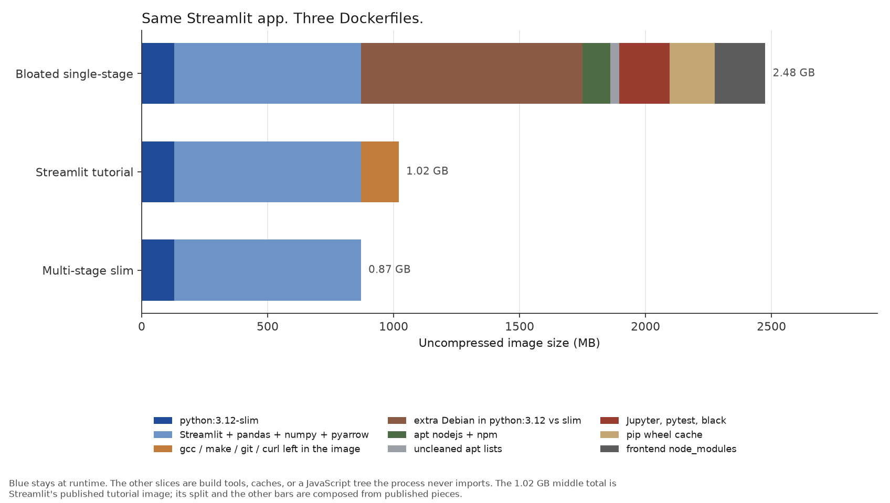
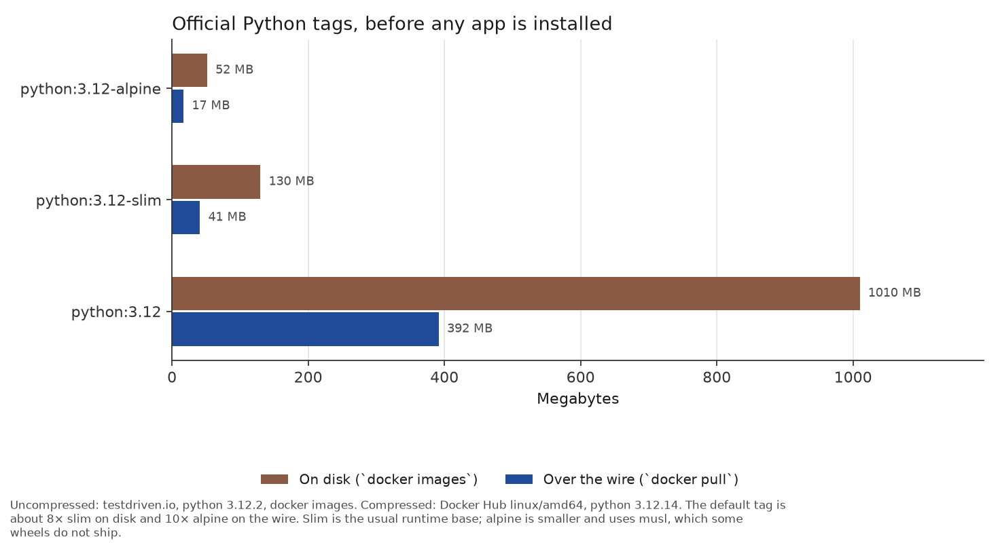
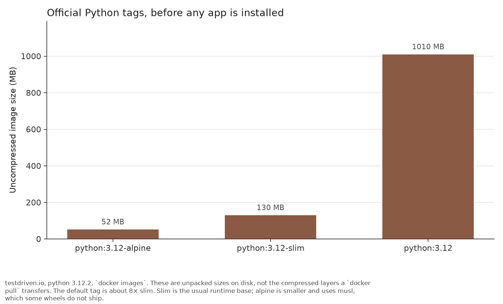
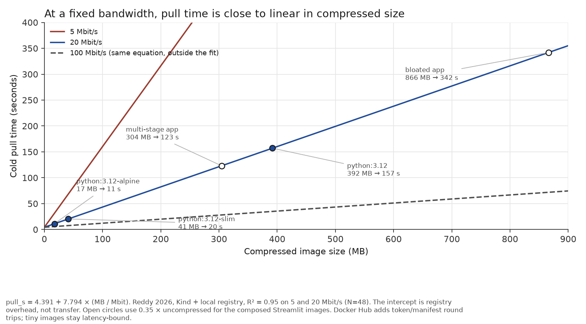

# Docker image size

A Streamlit app is a few Python files. The image that ships it is often a gigabyte because the build copied a compiler, a package-manager cache, and a JavaScript toolchain into the runtime.

There is no notebook. `plot.py` writes the four figures from `estimates.json`. `Dockerfile.bloated` and `Dockerfile.multistage` are the two recipes. The figures are a composed example, not a `docker build` from this machine. Streamlit's own tutorial image, the official Python tags, and the pull-time fit are published measurements. The slices that add up to the bloated bar are estimates anchored to those measurements.

## Same app, three Dockerfiles

The dummy app is `app/app.py`. It imports Streamlit. It does not import Jupyter, pytest, Node, or gcc. The bloated Dockerfile still installs all of them.



| Recipe | Uncompressed | What happened |
|---|---:|---|
| Bloated single-stage | 2.48 GB | `python:3.12`, extra apt packages, pip cache, Jupyter, `npm install` |
| Streamlit tutorial | 1.02 GB | `python:3.12-slim` plus `build-essential`, curl, and git left in the final image. Streamlit published this total. |
| Multi-stage slim | 0.87 GB | Builder compiles, then `/opt/venv` is copied onto slim. gcc, caches, and `node_modules` do not come along. |

The cut from 2.48 GB to 0.87 GB is not a faster Streamlit. It is refusing to ship the build. The remaining 0.87 GB is mostly the runtime: slim Python plus Streamlit's own stack. Pyarrow alone was 156 MB inside a 771 MB Streamlit map image ([Spatial Workflow](https://www.spatialworkflow.io/deploy-streamlit-app-docker/)). Multi-stage does not delete a library the process imports.

What the bloated recipe adds, and why:

**The default Python image already contains a compiler.** `python:3.12` is full Debian, about 1.01 GB on disk. `python:3.12-slim` is about 130 MB. The gap is gcc, g++, make, headers, git, wget, and the rest of the default tag's package set. testdriven.io counted 1,711 commands in bookworm and 509 in slim. Streamlit does not call gcc after the wheels are built. A multi-stage build can use gcc in the builder and omit it from the runtime.

**Package managers cache at build time.** pip writes wheels to `/root/.cache/pip`. If that directory is in a layer, the image holds a second copy of every download. A Flyte agent image had 813 MB there. TVM's CI images dropped 700 MB (CPU) and 1.6 GB (GPU) by passing `--no-cache-dir`. The bloated bar uses 180 MB as a modest stand-in for this app, not those CI images. apt keeps package indexes in `/var/lib/apt/lists`; leaving them is another 20–40 MB. BuildKit cache mounts (`--mount=type=cache,target=/root/.cache/pip`) keep the cache on the host so rebuilds stay fast without baking the cache into the image.

**Libraries the process never imports.** `app/requirements-dev.txt` adds Jupyter, pytest, and black. They are for the developer, not for `streamlit run`. They still occupy site-packages if `pip install` sees them.

**Build materials from another ecosystem.** `frontend/package.json` is a tiny React/webpack/TypeScript tree. `npm install` materializes `node_modules`. Streamlit never reads it. Copying a frontend build tree, a `.git` directory, or a local `.venv` with `COPY . .` is the same class of mistake. The multi-stage `.dockerignore` drops `frontend` from the context entirely.

The Streamlit tutorial is the middle bar because it is what their docs actually build: slim base, `build-essential` + curl + git, `pip3 install`, **1.02 GB**. They clean apt lists. They still leave the compiler in the final image, and they do not pass `--no-cache-dir`. The multi-stage file is that recipe with the build-time tools moved to a discarded stage.

## Base images, before any app





| Tag | On disk | Over the wire | What it is |
|---|---:|---:|---|
| `python:3.12-alpine` | 52 MB | 17 MB | musl, almost no extra packages |
| `python:3.12-slim` | 130 MB | 41 MB | glibc, minimal Debian, no compiler |
| `python:3.12` | 1,010 MB | 392 MB | glibc, full Debian, compiler and headers |

On-disk sizes are testdriven.io's `docker images` numbers for Python 3.12.2. Wire sizes are Docker Hub linux/amd64 compressed sizes for 3.12.14. Patch versions move; the ratio does not.

`docker pull` transfers compressed layers. `docker images` reports the unpacked filesystem. The default tag is about eight times slim on disk and about ten times alpine on the wire. Slim is the usual runtime choice for a glibc wheel. Alpine is smaller, and it uses musl, so some packages fall back to compiling from a source distribution — which is why the builder stage in a slim multi-stage build still installs gcc, rather than switching the runtime to alpine.

A FastAPI image built on those same families landed at 1.04 GB (bookworm), 171 MB (slim), and 75 MB (alpine) ([tchesnokov](https://blog.tchesnokov.net/posts/fastapi-+-docker-+-poetry-dev-production-setup/)). The base tag is the first-order term. The app on top is the second.

## Pull time, and whether it is linear



Under a bandwidth cap, cold pull time is close to linear in **compressed** size, plus a few seconds of registry work:

```
pull_ms = 4,391 + 7,794 × (compressed_MB / bandwidth_Mbit)
```

That is Reddy's 2026 Wisconsin–Madison honors thesis, Kind plus a local registry, R² = 0.95 on 48 shaped pulls at 5 and 20 Mbit/s. The intercept is DNS, TLS, the manifest, and the config. The slope is transfer plus a bit of unpacking. It is linear in size **at a fixed bandwidth**. It is not a line through the origin. Doubling the image does not quite double the time, because the 4.4 s tax does not grow.

On a 20 Mbit/s link, using that fit:

| Image | Compressed | Pull |
|---|---:|---:|
| `python:3.12-alpine` | 17 MB | 11 s |
| `python:3.12-slim` | 41 MB | 20 s |
| `python:3.12` | 392 MB | 157 s |
| Multi-stage Streamlit (estimated) | 305 MB | 123 s |
| Bloated Streamlit (estimated) | 866 MB | 342 s |

The two Streamlit rows use 0.35 × uncompressed as a stand-in for Hub compression. They are not measured pulls. The 100 Mbit/s line on the figure is the same equation outside the fit.

Three caveats stop this from being "time = size / bandwidth" on Docker Hub:

- **Tiny images are round-trip bound.** Sandboxer pulled `alpine:3.20` at 3.6 MB in 1.6 s. Most of that was the token, the manifest index, the manifest, and the config, each a separate Hub request.
- **Huge layers can become unpack-bound.** The same write-up had `node:22` at about 26 MB/s end-to-end, with the download of the largest layer more than three times faster than that. The rest was decompress and write.
- **The fit is a local registry with `tc` shaping, not Hub.** Hub adds the auth token dance. The slope still says the same thing: once the payload is hundreds of megabytes and the link is the bottleneck, extra megabytes cost extra seconds, roughly in proportion.

Harter et al. (FAST 2016) found that pulling accounted for 76% of container startup on average, and that only 6.4% of pulled bytes were needed to start doing useful work. Reddy's constrained runs put the pull share at a median 93%, and 99% for a 45 MB Python image at 5 Mbit/s. Image size is the lever when the node does not already have the layers.

## How to make the figures

```bash
cd docker-image-size
uv venv --python 3.13 .venv
uv pip install -r requirements.txt
.venv/bin/python plot.py
```

That writes `bloated_layers.png`, `base_images.png`, `base_images_on_disk.png`, and `pull_time.png`. Docker is not required.

## How to build the two images

From this directory, so the build context is not the rest of the repo:

```bash
docker build -f Dockerfile.bloated -t streamlit-bloated .
docker build -f Dockerfile.multistage -t streamlit-multistage .
docker images streamlit-bloated streamlit-multistage
```

The multi-stage file needs BuildKit (Docker's default for years) for the pip cache mount. A machine that actually builds these will not match the figure totals: Hub tags move, wheels move, and `npm install` is whatever those versions unpack to. The Dockerfiles are the recipe. The figures are the accounting.

```bash
docker run --rm -p 8501:8501 streamlit-multistage
```

## Sources

- Streamlit, [Deploy Streamlit using Docker](https://docs.streamlit.io/deploy/tutorials/docker): tutorial Dockerfile and the 1.02 GB `docker images` line.
- testdriven.io, [Docker Best Practices for Python Developers](https://testdriven.io/blog/docker-best-practices/): uncompressed `python:3.12.2` bookworm / slim / alpine, and a 259 MB → 156 MB cut from moving gcc to a builder.
- Docker Hub official `python` tags, linux/amd64 compressed sizes for 3.12.14 (default, slim, alpine).
- sluofoss, [Python Container Image Size Comparison](https://sluofoss.github.io/Learn/Data-Engineering/Python-Container-Image-Size-Comparison) (Dec 2024): `python:3.12` 1.01 GB, slim 123 MB, alpine 48 MB.
- tchesnokov, [FastAPI + Docker](https://blog.tchesnokov.net/posts/fastapi-+-docker-+-poetry-dev-production-setup/): same app on bookworm / slim / alpine, and the command-count split (1,711 vs 509).
- Spatial Workflow, [Deploy a Python map app with Docker](https://www.spatialworkflow.io/deploy-streamlit-app-docker/): 771 MB Streamlit image, 651 MB pip layer, pyarrow 156 MB.
- Flytekit [PR 1927](https://github.com/flyteorg/flytekit/pull/1927): 813 MB pip cache, 20–30 MB apt lists.
- TVM [PR 8575](https://github.com/apache/tvm/pull/8575): 700 MB / 1.6 GB saved by disabling the pip cache in CI images.
- Reddy, *Where Does the Time Go? Decomposing Kubernetes Pod Startup Latency Under Bandwidth Constraints*, University of Wisconsin–Madison honors thesis, 2026.
- Sandboxer, [Docker Image Pull Time in a Sandbox, Measured](https://sandboxer.com/guides/docker-image-pull-time-in-a-sandbox).
- Harter et al., [Slacker: Fast Distribution with Lazy Docker Containers](https://www.usenix.org/conference/fast16/technical-sessions/presentation/harter), FAST 2016.

## Limits

The bloated and multi-stage totals are sums of published pieces plus three labeled estimates (nodejs/npm, Jupyter/dev, `node_modules`). They are not `docker images` output from this folder. The Streamlit tutorial total is. The official Python tag sizes are.

Pyarrow, pandas, and numpy stay in the multi-stage image because Streamlit imports them. A "distroless" or alpine runtime can go smaller than slim and is a different compatibility bet. This example stays on slim so the comparison is the build recipe, not a libc change.

Layer sharing is ignored. A node that already has `python:3.12-slim` only pulls the new layers. The pull-time figure is a cold pull of the whole compressed image, which is the first deploy and the new-node case.

The linear model is a bandwidth-capped local registry. Docker Hub, a city-scale link, and a saturated SSD will not reproduce the 4.4 s intercept or the 7,794 ms coefficient. The claim that survives that is smaller: extra compressed megabytes cost extra seconds when the network is the bottleneck, with a fixed registry tax that matters more for small images than for large ones.
