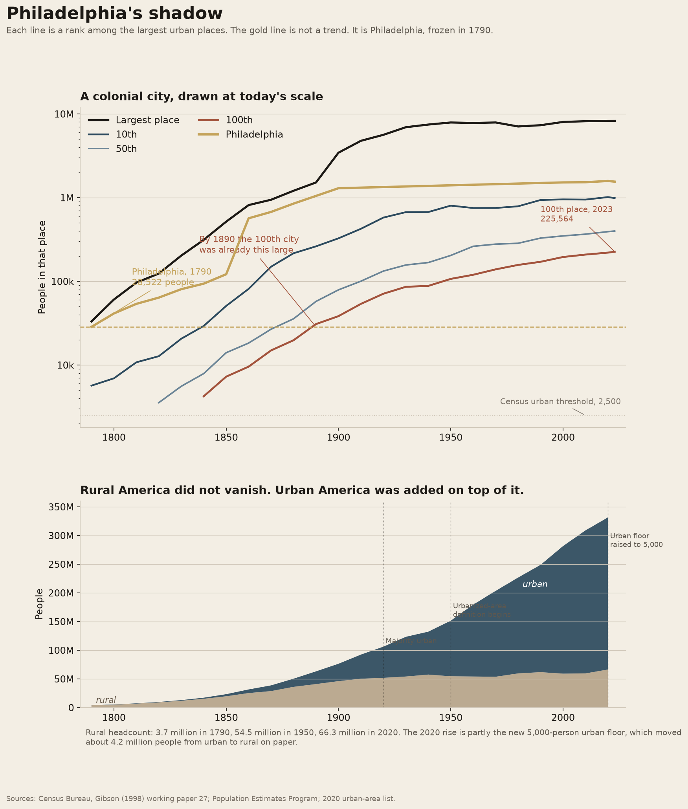
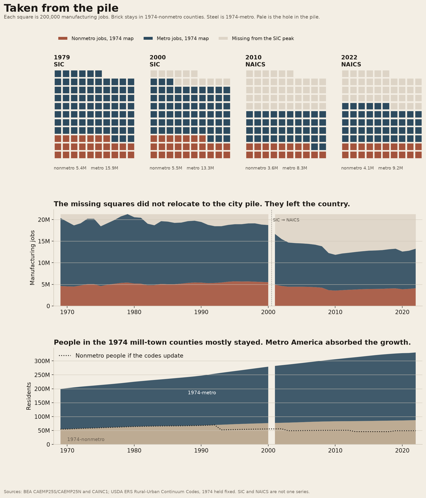

# Small-town America

Whether mill-town America disappeared when manufacturing left, or whether "rural" just stopped meaning what it used to.

The notebook is `urbanization.ipynb`. It writes the figures in this folder. Cached downloads stay in the repo-root `data/small-town-america/` folder.

Open the notebook from this directory so `../data` resolves.

Bowling Alone is a book about associations. Under it is a geographic claim that is hard to see in a single official urban-share chart. The industrial revolution put factories in small cities, and people lived next to the mill. When the mill closed, the story goes, the town emptied and the work followed the people into the big city. Two measurement problems sit inside that sentence. Philadelphia in 1790 had 28,522 people and was the second city of the United States; a place that size is not a city now. And the Census line for "urban" was 2,500 people for most of American history, then 5,000 in 2020, so a rising or falling rural *share* can be a change in the ruler.

The notebook holds the 1974 metro map fixed when it counts manufacturing jobs, so a county that later gets annexed into a metro area does not vanish from the mill-town pile. A second split lets the USDA rural-urban codes update, which is urbanization that happens on paper.

## Philadelphia's shadow

Each line is a rank among the largest urban places. The gold line is not a trend. It is Philadelphia in 1790, frozen. The lower panel is people, not a percent.



Philadelphia had 28,522 people in 1790. By 1890 the 100th American urban place was already 30,801. By 2020 the 100th incorporated place was 219,945. Philadelphia itself is about 1.55 million. The second city of the early republic is, as a size, below the 100th city of today.

Of 2,611 urban areas in the 2020 Census, 1,923 are smaller than Philadelphia in 1790. About 245 million people, 74% of the country, live in an urban area at least that large. In 1790, two places were that large, and they held about 62,000 people.

Rural America as a headcount did not collapse. It was 3.7 million in 1790, 54.5 million in 1950, 59.5 million in 2010, and 66.3 million in 2020. Urban America was added on top: 0.2 million, then 97 million, then 249 million, then 265 million. The country became urban because cities grew, not because the rural count went to zero. The first census with an urban majority is 1920, 54.3 million urban of 106.0 million.

The 2020 rural increase is partly definition. The Census raised the urban floor from 2,500 people to 5,000 people or 2,000 housing units, and about 4.2 million people in 1,140 places moved from urban to rural on paper. That is not a migration wave.

Seventy-six places that had ever been among the 100 largest were below 80% of their own census peak by 1990. Johnstown was at 42% of 1920. Youngstown, Scranton, Wilkes-Barre, Buffalo, Cleveland, Detroit, and Pittsburgh sit in that set. The city proper shrank. That is a different fact from the rural headcount, which held.

## Taken from the pile

Each square is 200,000 manufacturing jobs. Brick is counties that were nonmetro in 1974. Steel is counties that were already metro in 1974. Pale squares are jobs that existed at the 1979 SIC peak and are not in that year's remaining pile. The map does not chase the jobs.



The pile was not carried from mill towns into cities.

On the 1974 map, manufacturing jobs peaked in 1979 at 21.3 million: 5.4 million in nonmetro counties, 15.9 million in metro counties. By 2000, still on SIC, the national pile was 18.8 million. Nonmetro jobs were 5.5 million, slightly *up*. Metro jobs were 13.3 million, down 2.6 million. The missing squares in 2000 came off the city pile.

NAICS is a new industrial list in 2001, so 2000 and 2001 are not one step. From 2001 to 2022 both sides shrink: nonmetro manufacturing from 4.9 million jobs to 4.1 million, metro from 11.8 million to 9.2 million. The hole in the 2022 waffle is jobs that left the country, not jobs that moved down the road. Remaining manufacturing is *more* nonmetro as a share on this fixed map, 25.5% at the 1979 peak and 30.8% in 2022.

People in the same 1974-nonmetro counties went from 54.5 million in 1969 to 87.0 million in 2022. People in 1974-metro counties went from 144.9 million to 243.3 million. The mill-town counties did not empty. Almost all of the country's growth sat on the metro side of a fifty-year-old line. Indexed roughly to 1969, those nonmetro counties are about 89 on manufacturing jobs and 160 on residents. The job index crosses the SIC/NAICS seam, so it is a sketch.

If the rural-urban codes are allowed to update, 2022 "nonmetro" is 2.6 million manufacturing jobs and 49 million people, not 4.1 million and 87 million. Of 2,484 counties that were nonmetro in 1974, 562 were metro by 2023. About 38 million people in 2022 live in a county that was small-town America on the 1974 map and is metro now. They did not have to move. The definition moved.

## How to run

```bash
cd small-town-america
uv venv --python 3.13 .venv
uv pip install -r requirements.txt
```

Open the notebook with that environment and run all cells. The first run downloads Gibson's place tables, Census place estimates, the 2020 urban-area list, BEA county employment and population, USDA rural-urban codes, and FRED `MANEMP`. Later runs reuse `../data/small-town-america/`.

## Sources

- Campbell Gibson, Census Population Division Working Paper No. 27, *Population of the 100 Largest Cities and Other Urban Places in the United States: 1790 to 1990* (1998), tables 2–24.
- Census Population Estimates Program incorporated-place files, SUMLEV 162: intercensal 2000–2010, 2010–2020, and 2020–2023.
- National urban and rural counts: Census CPH-2 Table 4 (1790–1990, current urban definition from 1950), Census 2000 and 2010 SF1 table P2, 2020 Census urban-area facts. 1960 rural uses the post-publication correction of 54,054,425.
- Census 2020 urban area list, United States only.
- BEA CAEMP25S (SIC manufacturing, line 400, 1969–2000) and CAEMP25N (NAICS manufacturing, line 500, 2001–2022), county full-time and part-time jobs, including proprietors. Last BEA vintage for these discontinued tables.
- BEA CAINC1 line 2, county population.
- USDA ERS Rural-Urban Continuum Codes, vintages 1974, 1993, 2003, 2013, and 2023. Metro is codes 0–3 in the early vintages and 1–3 later.
- FRED `MANEMP`, BLS Current Employment Statistics manufacturing payroll employment, used only as a national check on the era of the peak.

## Limits

Gibson's ranks through 1990 are urban places as the Census then defined them. The 2000–2023 ranks are incorporated places. A large CDP can sit in one list and not the other. Annexation also moves people into a city without anyone changing house.

The national urban/rural series changes definition in 1950 and in 2020. Rural in that series is everyone outside urban territory, including small places the current threshold left out.

BEA manufacturing jobs include proprietors and are suppressed in some counties (`(D)`). About 4% of counties are missing a number in 1979, about 11% in 2022. Suppression is more common in small counties, so the nonmetro pile is a lower bound. SIC manufacturing in 2000 is not NAICS manufacturing in 2001. Pale squares after 2000 mix a real loss with a change in industrial classification.

The 1974 Rural-Urban Continuum is a county line, not a town line. A mill town inside a county that OMB already called metro in 1974 sits in the steel pile. Some Virginia independent cities are combined in BEA and unmatched to ERS, so they drop out of the join. About 1% of manufacturing rows have no 1974 code.

None of this is a civic-life survey. It is jobs and people. Putnam's associations are a different file.
