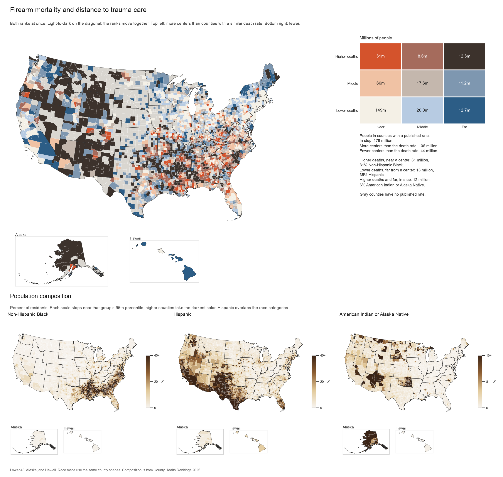
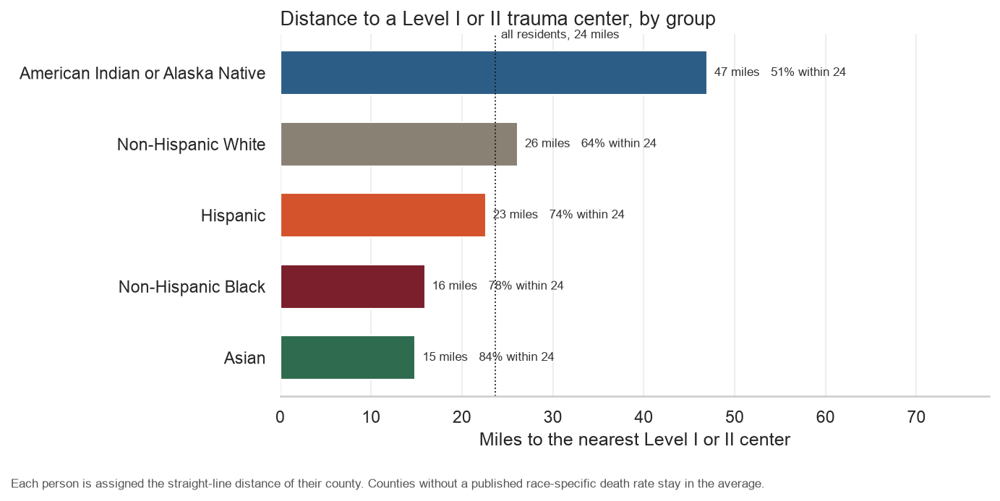
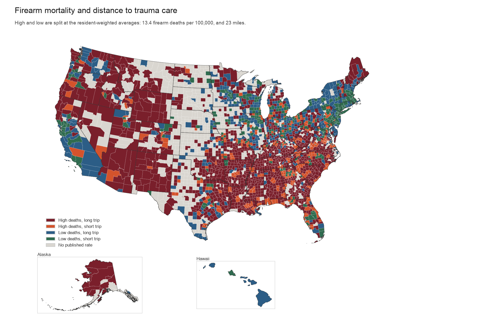
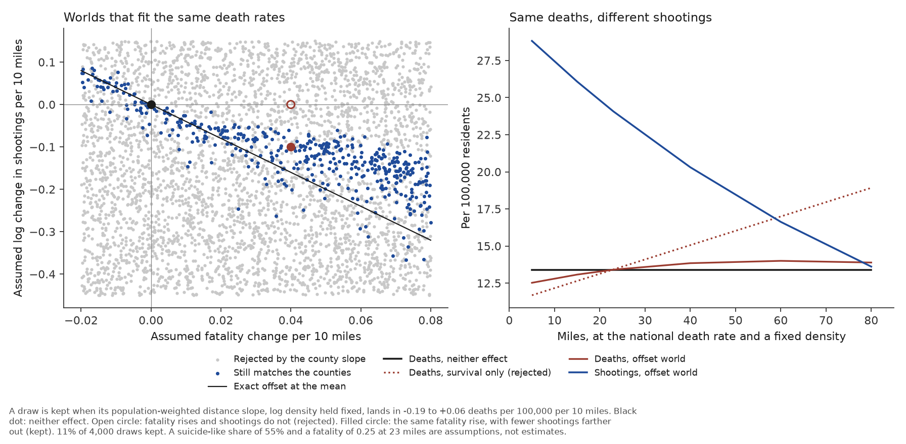
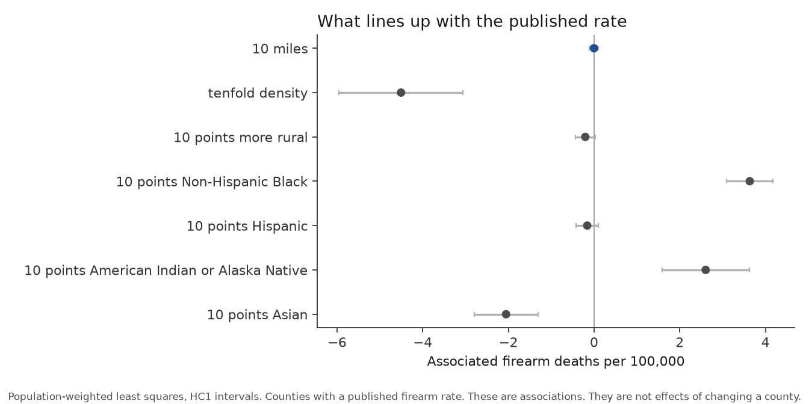

# Trauma deserts

How far each US county sits from an adult Level I or Level II trauma center, and the firearm death rate that county publishes.

The notebook is `trauma_deserts.ipynb`. It writes the figures in this folder. Cached downloads stay in the repo-root `data/trauma-deserts/` folder.

Open the notebook from this directory so `../data` resolves.

The motivating claim is about survival after a shooting. Urban studies of gunshot wounds, including the Chicago trauma-desert work, find that a longer trip to a high-level center lowers the chance of surviving a penetrating injury. The death rate beside the distance is a different quantity: firearm deaths of every intent, per 100,000 residents. In rural counties most of those deaths are suicides.

## Firearm mortality and distance, by rank

Counties with a published firearm rate are split into thirds on distance and thirds on the death rate. The diagonal of the grid is the proportional pattern: a low rate with a nearby center, or a high rate with a long distance. Off that diagonal, the county has more Level I or II access than counties with a similar death rate, or less. The numbers in the grid are people.



Of the people in counties with a published rate:

- 179 million live where the two ranks match. Most of them, 149 million, are in the near, lower-death cell.
- 106 million live nearer a center than their death rate suggests. The sharp corner of that class is 31 million people with a high death rate and a center nearby. Those counties are 31% Non-Hispanic Black. Philadelphia, Shelby County (Memphis), Wayne County (Detroit), and DeKalb County sit here.
- 44 million live farther from a center than their death rate suggests. The sharp corner is 13 million people with a low death rate and a long distance, 35% Hispanic. Hidalgo, Cameron, and Webb counties in south Texas are in that corner, along with inland California counties such as San Bernardino and Tulare.

The third corner, high deaths and far from a center, is on the diagonal: the ranks match, and both are high. It holds 12 million people and is 6% American Indian or Alaska Native, against about 1% in the counties nearest a center. Gray counties, 6.5 million people, have no published rate and are left out of the grid.

The lower maps are population composition, not a race-specific death rate. CHR publishes a Black firearm rate for 643 counties, a Hispanic rate for 320, and an American Indian or Alaska Native rate for 48. Those rates cannot fill a national map. The shares can. Hispanic origin overlaps the race categories, so the three maps are not slices of one total.

Composition tracks the death rate, and it does not erase the distance pattern on its own. With the four shares held fixed, an extra 10 miles still lines up with 0.47 more deaths per 100,000 when each county counts once (95% CI 0.36 to 0.57), and 0.36 when counties are weighted by population. A 10-point higher Non-Hispanic Black share lines up with about 2.6 to 3.0 more deaths per 100,000. A 10-point higher American Indian or Alaska Native share lines up with about 1.6 to 3.2. Hispanic share lines up with a small decrease. Asian share lines up with a decrease, and a 10-point difference in that share is a large gap between counties: the median county is under 1% Asian.

Density still changes the distance result. With log density and composition both held fixed, the county-equal distance slope is 0.13 deaths per 100,000 per 10 miles (95% CI 0.03 to 0.22). Weighted by population, that slope is 0.00 (95% CI −0.11 to 0.11). The Black and American Indian or Alaska Native terms remain.

## Average distance, and whether gun deaths rise with it

A resident-weighted mean is the average a person lives with. A county-equal mean is pulled out by empty counties. Rural here means the county is at least half rural in the County Health Rankings file.

| | People | Resident-weighted miles | County-equal miles |
|---|---:|---:|---:|
| Nationwide | 335 million | 24 | 59 |
| Urban counties | 287 million | 19 | 44 |
| Rural counties | 48 million | 50 | 67 |

Among counties that publish a firearm rate, the resident-weighted averages are 23 miles and 13.4 deaths per 100,000. Urban counties in that set average 19 miles and 12.9 deaths per 100,000. Rural counties average 48 miles and 17.3. Rural distance is about 2.5 times the urban distance. The rural death rate is about 1.3 times the urban rate. Even this split is not proportional: distance rises more than the death rate.

If firearm deaths and distance rose together, a county twice the national death rate would sit twice as far from a Level I or II center. A county is off that line only when it is above the national average on one measure and that excess is at least twice the other. A below-average death rate next to a trauma center is not an outlier.

| | Counties | People | Black | Hispanic | American Indian or Alaska Native |
|---|---:|---:|---:|---:|---:|
| Gun deaths and distance rise together | 1,507 | 206 million | 11% | 19% | 1.2% |
| High gun deaths, but a center is close | 182 | 80 million | 22% | 20% | 1.1% |
| Far from a center, but deaths stay low | 617 | 43 million | 5% | 23% | 2.4% |

The largest places where gun deaths are high and a center is close are Cook County (Chicago), Harris County (Houston), Maricopa County (Phoenix), Dallas County, Clark County (Las Vegas), Tarrant County, Bexar County (San Antonio), and Wayne County (Detroit). Cook is 18 deaths per 100,000 and 1.3 miles from a center. Wayne is 24 per 100,000 and 3.5 miles.

The largest places that are far from a center without a matching death rate are San Diego, Riverside, and San Bernardino in California, Hidalgo County in Texas, Ocean County in New Jersey, Spokane County in Washington, Washoe County in Nevada, and Tulare County in California. Hidalgo is 5.9 deaths per 100,000. Ocean County is 3.5. San Diego is 6.7.

Among those off-line counties, the log of (relative death rate ÷ relative distance) correlates 0.56 with the Non-Hispanic Black share, −0.08 with the Hispanic share, and −0.15 with the American Indian or Alaska Native share. Black share is what tracks which way a county falls off the line. Hispanic share does not separate the two classes. American Indian or Alaska Native share is only a little higher on the far side.

## Firearm death rates by group

A death count by race is not in the file. The county-wide count correlates −0.18 with distance, because a larger county has more deaths and is more likely to contain a Level I or II center. The table uses the published rate for each group.

| Group | Counties with a published rate | Correlation with distance | Extra deaths per 100,000 per 10 miles |
|---|---:|---:|---:|
| American Indian or Alaska Native | 48 | 0.56 | 0.5 |
| White | 2,120 | 0.35 | 0.7 |
| Hispanic | 320 | 0.35 | 0.5 |
| Black | 643 | 0.17 | 1.0 |
| Asian | 61 | 0.02 | 0.0 |

For White, Hispanic, and American Indian or Alaska Native residents, a longer trip lines up with a higher firearm death rate. The American Indian or Alaska Native line is the tightest of the five, and it rests on 48 counties, many of them in Alaska and the northern Plains. The White and Hispanic lines are real and loose. For White residents the line accounts for 12% of the variation in the rate.

The Black slope per mile is actually a bit steeper than the White slope, and the points do not follow it. The correlation is 0.17, and the line accounts for 3% of the variation. Black firearm death rates are high in counties that already have a center nearby and in counties that do not. The Asian line is flat, and the rates stay low. Those two groups are also the ones CHR can publish for the fewest counties.

## Distance to trauma care by group

Every resident is assigned the distance of their own county. A county with no published race-specific death rate still counts. These miles are the access comparison.



| Group | People | Miles | Share living within 24 miles |
|---|---:|---:|---:|
| Asian | 21 million | 15 | 84% |
| Non-Hispanic Black | 42 million | 16 | 78% |
| Hispanic | 65 million | 23 | 74% |
| Non-Hispanic White | 195 million | 26 | 64% |
| American Indian or Alaska Native | 4.5 million | 47 | 51% |

Black residents live closer to a Level I or II center than White residents, and closer than the national average. Asian residents live closest. American Indian or Alaska Native residents live about twice as far as the national average, and 29% live 50 miles or more out. Hispanic origin overlaps the race categories, so these rows are not slices of one total.

A rising line of deaths against distance is not a count of deaths a trauma center prevented. The file has no record of people who were shot and survived. The firearm rate also mixes suicide and homicide. What the lines show is that, for some groups, counties farther from a center publish higher firearm death rates.

## Mortality and distance classes

Counties with a published firearm rate are split at the resident-weighted national averages, 13.4 deaths per 100,000 and 23 miles.



- High deaths, long trip: 1,259 counties, 56 million people. The death rate is high and the center is farther than average.
- High deaths, short trip: 305 counties, 95 million people. The death rate is high beside a center that is already closer than average.
- Low deaths, long trip: 427 counties, 49 million people. The center is far and the death rate is still below average.
- Low deaths, short trip: 315 counties, 128 million people. A close center and a below-average death rate sit together.

Gray counties have no published firearm rate.

## Where gun deaths are high and a center is far

A county is in this set when it is at least 1.5 times the resident-weighted national average on both measures: at least 20.2 firearm deaths per 100,000, and at least 34 miles from a Level I or II center. That is 530 counties, 15.7 million people, and 20,758 firearm deaths in the 2018–2022 window CHR uses as the numerator.

The people in these counties are 17% Non-Hispanic Black, 10% Hispanic, 4.9% American Indian or Alaska Native, and 65% Non-Hispanic White. Black and American Indian or Alaska Native shares are higher than in the counties that sit in proportion. They are not high enough to say the set is usually one group. The American Indian or Alaska Native share is concentrated in particular counties rather than spread across the set.

The largest counts in the window:

- Cumberland County, North Carolina, 380 deaths, 23 per 100,000, 53 miles. Fayetteville. 38% Non-Hispanic Black.
- Yavapai County, Arizona, 349 deaths, 29 per 100,000, 66 miles.
- Mohave County, Arizona, 346 deaths, 32 per 100,000, 78 miles.
- Lafayette Parish, Louisiana, 248 deaths, 20 per 100,000, 59 miles. 27% Non-Hispanic Black.
- Montgomery County, Tennessee, 237 deaths, 22 per 100,000, 41 miles.
- Robeson County, North Carolina, 205 deaths, 33 per 100,000, 74 miles. 23% Non-Hispanic Black and 42% American Indian or Alaska Native.
- Ouachita Parish, Louisiana, 202 deaths, 26 per 100,000, 82 miles. 38% Non-Hispanic Black.
- Florence County, South Carolina, 182 deaths, 26 per 100,000, 76 miles. 43% Non-Hispanic Black.
- Yellowstone County, Montana, 170 deaths, 21 per 100,000, 250 miles.
- San Juan County, New Mexico, 141 deaths, 23 per 100,000, 137 miles, 44% American Indian or Alaska Native. Navajo County, Arizona, is the same kind of place: 133 deaths, 24 per 100,000, 75 miles, 44% American Indian or Alaska Native.
- Fairbanks North Star Borough, Alaska, 144 deaths, 30 per 100,000, 271 miles.

## Does a closer trauma center invite more gun violence?

The naloxone comparison is a risk-compensation claim. If a drug or a hospital makes death less likely, some people may take more risk. For naloxone, that claim is disputed. One line of research tied broader access laws to more opioid-related emergency visits and opioid-related crime. Later work found the result depended on how the laws were dated and what else states changed at the same time. It is not an established result that naloxone makes drug use more prevalent.

A trauma center would fit that story only if gun deaths were higher where a center is close. The raw death count leans that way, and it is the comparison that mixes in county size. The death rate, which takes population out, rises with distance for White, Hispanic, and American Indian or Alaska Native residents. It does not fall. Black firearm death rates are high on both ends of the distance scale, including in cities that already contain a Level I or II center. Holding density fixed, and weighting counties by population, the distance slope on the county firearm rate is about zero.

This file is not a center opening and the shootings that followed. Centers are placed where people and hospitals already are. The firearm rate also mixes suicide and homicide, and a suicide is often fatal before an ambulance is called. These maps do not show that building trauma centers produces gun violence.

## What remains after density

Among the 2,306 counties with a published rate, distance and the firearm rate move together before any other control (r = 0.31). An extra 10 miles lines up with 0.53 more deaths per 100,000 (95% CI 0.42 to 0.64).

Distance and log population density move together too (r = −0.60). A tenfold increase in density lines up with 5.3 fewer firearm deaths per 100,000. With that density term in the model, the county-equal distance slope shrinks to 0.10 deaths per 100,000 per 10 miles (95% CI 0.002 to 0.20, p = 0.046). The same model weighted by population is −0.06 per 10 miles, and the interval includes zero (p = 0.32). Dropping the farthest 1% of counties also puts the unweighted interval across zero (p = 0.085). Distance and density together have R² = 0.21, and density accounts for most of that.

Homicide rates in the same file, all methods, have no distance slope once density is held fixed (−0.01 deaths per 100,000 per 10 miles, p = 0.79, 1,425 counties). CHR publishes that rate for 96% of the near counties and 34% of the far ones.

## The split the death rate cannot show

A firearm death rate is a product. Part of it is suicide, usually complete before a trauma center can matter. The rest is shootings that were fatal. A closer center can lower the chance that a shooting kills. People can also be shot more often where a rescue is close. Those two changes push the published rate in opposite directions. One cross-section of deaths cannot say how much of each is happening.

The file has no count of people who were shot and lived, and no years before and after a center opened. An equation that needs either of those is not identified. The notebook `masking_simulation.ipynb` stays inside `county_distance.csv`. It draws the two unknown pieces, then keeps only the draws that still reproduce the density-adjusted distance slope.



What is identified is the regression. Among the 2,306 counties with a published rate, holding log density fixed and weighting by population, an extra 10 miles lines up with −0.06 firearm deaths per 100,000 (95% CI −0.19 to +0.06). In a model that also holds rural share and the race and Hispanic shares fixed, removing distance changes the weighted R² by less than 0.001. Removing the race and Hispanic shares drops it by 0.43, from 0.52 to 0.10. Removing log density and rural share together drops it by 0.06. County-equal R² tells the same order: the shares, then density, then distance at about 0.003.



Read as associations, population-weighted, with robust intervals: a tenfold increase in density lines up with 4.5 fewer deaths per 100,000. A 10-point higher Non-Hispanic Black share lines up with 3.6 more. A 10-point higher American Indian or Alaska Native share lines up with 2.6 more. A 10-point higher Asian share lines up with 2.1 fewer. Ten miles lines up with about zero (−0.00, 95% CI −0.11 to +0.10). The rural term is what is left after density, and its interval includes zero. A county percentage is not a person's risk. Hispanic origin overlaps the race categories. None of these coefficients is an estimate of what would happen if the share, the density, or the miles were changed.

The Monte Carlo uses two assumptions the file does not measure. It treats 55% of the death rate as suicide-like, in the neighborhood of the national firearm mix, and it treats the fatality of the rest as 0.25 at the resident-weighted mean of 23 miles. Four thousand draws vary how fast fatality rises with miles and how fast shootings change with miles. Eleven percent of them, 444, land inside the interval above. They fall along a line. One end of that line is no distance effect at all. Farther along it, fatality rises with miles and shootings fall with miles by enough to cancel. The counties do not choose a point on the line.

One kept example raises fatality by 0.04 per 10 miles and lowers shootings by about 10% per 10 miles farther out. At a fixed density, deaths in that world stay between about 13 and 14 per 100,000 from 5 miles to 80. The implied shootings fall from about 29 per 100,000 at 5 miles to about 14 at 80. The same fatality rise with no change in shootings is rejected. It would add about 1.0 death per 100,000 per 10 miles, and the counties do not show that. Building a center, or refusing to, is not a result this cross-section can prescribe. The prescription depends on where you stand on that line, and the line is the assumption.

After a population-weighted fit on log density, rural share, and the race and Hispanic shares, with distance left out, 882 of the 1,259 high-death, long-trip counties are still above their fitted rate. They hold 40 million people. The residual rate, scaled by population, is about 1,800 deaths a year. American Indian or Alaska Native residents are 2.3% of that population, against 2.8% in the raw corner. Forty-five of the 882 counties are at least 10% American Indian or Alaska Native, and they hold 1.6 million of the 40 million. The largest leftovers are Pima County, Arizona; Lake County, Indiana; and Yavapai and Mohave counties in Arizona. The residual corner is not an American Indian or Alaska Native set.

```bash
cd trauma-deserts
.venv/bin/python masking_simulation.py
```

## How the miles were measured

The hospital layer contributes 564 open adult Level I or II centers: 239 Level I and 321 Level II in the lower 48, three Level II centers in Alaska, and one Level I center in Hawaii. The median county centroid is 43 miles from the nearest of them. A quarter of counties are within 26 miles. Aleutians West is about 1,001 miles from Central Peninsula General Hospital in Soldotna.

About 78 million people live in the 133 counties under 5 miles. About 77 million live in the 2,157 counties at 30 miles or more.

| Distance | Counties | Population | Share with a published firearm rate | Population-weighted rate | Median county rate |
|---|---:|---:|---:|---:|---:|
| Under 5 miles | 133 | 77.8 million | 98% | 14.0 | 13.5 |
| 5–15 miles | 227 | 104.7 million | 96% | 12.0 | 12.4 |
| 15–30 miles | 627 | 75.5 million | 89% | 12.2 | 14.4 |
| 30 miles or more | 2,157 | 76.9 million | 65% | 16.3 | 18.3 |

Rates are firearm deaths per 100,000, all intents, 2018–2022, from the County Health Rankings 2025 annual file. The weighted rate uses county population. Counties with no published rate stay in the population column and drop out of the rate.

## How to run

```bash
cd trauma-deserts
uv venv --python 3.13 .venv
uv pip install -r requirements.txt
```

Open the notebook with that environment and run all cells. The first run downloads the Census county file, the HIFLD hospital layer, and the County Health Rankings file. Later runs reuse them.

## Sources

- Census Bureau 2023 cartographic county boundaries, 1:500,000 (`cb_2023_us_county_500k`).
- HIFLD open hospitals, via the public `Hospitals_hifld` feature service. Adult Level I and II are parsed from the free-text `TRAUMA` field. Open hospitals only.
- County Health Rankings 2025 annual analytic file: firearm fatalities, homicides, the rural share, and the percent of residents who are Non-Hispanic Black, Hispanic, Non-Hispanic White, American Indian or Alaska Native, and Asian. CHR documents the 2025 annual firearm measure as 2018–2022 deaths from NCHS mortality files.

## Limits

These layers describe centroid distance and a published death rate. They do not describe the share of shooting victims who die.

The firearm rate counts suicides, homicides, unintentional shootings, and legal intervention. Suicide is a large share of firearm deaths, and it is more common in rural counties, which are also farther from trauma centers. Density is a coarse stand-in for that mix. The homicide fit moves the outcome toward interpersonal violence. It still counts every method, and it still measures how often residents die rather than how often a person who was shot survives.

The miles are a straight line from the centroid of the county land polygon. In a large county that point can sit far from the town where people live. Alaska is matched only to Alaska centers, and Hawaii only to Hawaii centers. A Level III or IV center, a pediatric-only center, and a slow road do not enter the number. HIFLD strings that never say Level I or II, including several state labels for regional centers, are left out. The file does not say whether a military hospital accepts civilian trauma.

Aleutians West is stored by the Census with part of the borough east of the antimeridian. The notebook shifts those parts by 360 degrees before measuring. Unshifted, the centroid falls in central Canada.

Suppression is part of the pattern. Counties with few deaths, which tend to be small and often far, are missing from the weighted rates and from the colored classes on both maps. The gray counties are those places.

The rank grid compares thirds among counties with a published rate. A county in the far third can still be much closer than the Aleutians. The composition maps are who lives in the county. A county percentage is not a person's risk, and Hispanic origin overlaps the race categories.

The race lines use the firearm death rate CHR publishes for that group. Black rates are published for 643 counties, Hispanic rates for 320, American Indian or Alaska Native rates for 48, and Asian rates for 61. Counties with too few deaths in that group are missing, and those missing counties are not a random sample of places.
